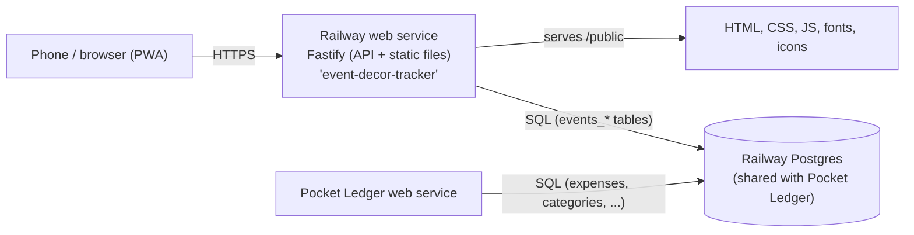

# Event Decor Tracker: Architecture and Build Spec

A single-user, mobile-first event/job tracker for an Indian-traditional and balloon decor business, hosted on Railway. This document is the brief for implementation. It describes what to build, how it fits together, and the order to build it in.

---

## 0. How to use this document

1. This app is a structural twin of an existing sibling app, "Pocket Ledger" (a personal expense tracker: `github.com/mahesh539dev/personalexpensetracker`). Follow the same stack, conventions, and auth scheme described below — do not introduce a different backend language, ORM, or frontend framework.
2. Build milestone by milestone (section 11). Run tests and commit at the end of each milestone. Every milestone has acceptance criteria.
3. Do not add libraries, services, or features that are not listed here without asking. Prefer fewer dependencies.
4. This app shares a Postgres **server** with Pocket Ledger but owns its own tables and its own migration history, tracked independently (section 4). It is a separate deployable with its own login — not a tab inside Pocket Ledger.

---

## 1. Product summary

The owner runs a decor business doing two kinds of jobs — **Indian traditional decor** and **balloon decor** — delivered as either a **rental** (owner drops off/sets up rented decor items) or a **service** (owner provides a decorating service). Every job is logged as one **event**.

For each event, track:
- Customer name (required) and phone (optional)
- Event date (date picker)
- Event type — free text, e.g. "Wedding", "Birthday", "Baby Shower"
- Decor style — Indian Traditional, Balloon, or Both
- Job type — Rental or Service
- Event price
- Payments: a deposit (amount + date paid) and a "rest" payment (amount + date paid) — exactly two slots
- Due amount — computed: price − (deposit + rest)
- Status — Outstanding or Done. Auto-suggested (event date has passed AND due is fully paid ⇒ Done) but manually overridable at any time
- Expenses incurred for the event — a list of {amount, note, date}, e.g. "bought extra balloons at Party City"
- Final (net) amount — computed: (deposit + rest) − total expenses

A **Reports** page covers a selected period (a specific month, or a custom date range) and shows:
- Totals: revenue (sum of price), amount collected, total expenses, net profit, outstanding dues
- The list of events falling in that period
- A breakdown of totals by Rental vs Service
- A breakdown of totals by event type (grouped by exact text match)

Installable on the phone's home screen (PWA). Protected by a password, independent from Pocket Ledger's login.

Scale: one user, low hundreds of events per year. Optimize for simplicity, low cost, low maintenance — not throughput.

---

## 2. Decisions

| Area | Decision | Why |
|---|---|---|
| Backend | Node.js 22 LTS, TypeScript, Fastify 5 | Matches Pocket Ledger; one language end to end, small footprint, easy Railway deploy |
| Database | The *same* Railway Postgres service Pocket Ledger uses, `pg` driver, plain SQL migrations, own `schema_migrations`-equivalent table | Reuses existing paid infra; table-name prefixing keeps the two apps' migrations from ever colliding |
| Frontend | Vanilla JavaScript (ES modules), no framework, no build step | Matches Pocket Ledger; smallest footprint to maintain |
| Auth | One password, signed httpOnly session cookie — same scrypt + HMAC scheme as Pocket Ledger, copied as a small shared module, own secret and own cookie name | Single user, no accounts; reusing a proven, already-audited scheme beats inventing a new one |
| Hosting | Railway: a new web service in the same project, pointed at the existing Postgres service via its own `DATABASE_URL` | One Postgres bill, two independent deployables |
| Installability | PWA (manifest + service worker for static assets) | Home-screen icon, standalone window, matches Pocket Ledger |
| Money | Integer cents in the database and API | No floating-point errors |
| Dates | Calendar dates (`YYYY-MM-DD`), no time zones | An event/payment/expense belongs to a day, not an instant |

---

## 3. System overview



- One deployable, separate from Pocket Ledger's. Fastify serves the JSON API under `/api` and the static frontend from `/public`. Same origin, so there is no CORS.
- The frontend fetches data on demand. No websockets, no live subscriptions. After any mutation, refetch the current view.
- The Postgres server is shared infrastructure; the database/schema boundary between the two apps is enforced purely by table naming (`events_*` prefix) plus a separate migration-tracking table (`events_schema_migrations`) so a migration run by one app never touches the other's tables or history.

---

## 4. Repository layout

```
event-decor-tracker/
├─ ARCHITECTURE.md              # this document, copied in at repo root
├─ src/
│  ├─ index.ts                  # boot: load config, run migrations, listen on 0.0.0.0:$PORT
│  ├─ app.ts                    # builds the Fastify instance (used by tests too)
│  ├─ config.ts                 # env parsing and validation (zod)
│  ├─ db.ts                     # pg Pool, DATE parser returns strings, migration runner (events_schema_migrations)
│  ├─ auth.ts                   # scrypt password check + HMAC session sign/verify, ported from Pocket Ledger
│  ├─ schemas.ts                # zod request schemas
│  └─ routes/
│     ├─ auth.ts  events.ts  expenses.ts  reports.ts  health.ts
├─ migrations/
│  └─ 0001_init.sql
├─ public/
│  ├─ index.html
│  ├─ manifest.webmanifest
│  ├─ sw.js
│  ├─ css/app.css
│  ├─ js/
│  │  ├─ main.js                # boot, auth gate, event delegation
│  │  ├─ api.js                 # the only module that calls fetch()
│  │  ├─ state.js               # app state
│  │  ├─ money.js  dates.js  periods.js  compute.js   # pure functions (unit tested): due amount, final amount, auto-status, period bucketing
│  │  ├─ views/{eventList,eventForm,reportList}.js
│  │  └─ ui.js                  # toast, sheets, inert handling
│  ├─ fonts/
│  └─ icons/
├─ scripts/hash-password.ts
├─ test/
├─ docker-compose.yml           # local Postgres only (or point at existing shared instance via .env)
├─ Dockerfile
├─ railway.json
├─ .env.example
├─ package.json
└─ tsconfig.json
```

`package.json` scripts: `dev`, `build`, `start`, `test` (vitest), `migrate`, `hash-password` — same names as Pocket Ledger.

---

## 5. Data model

PostgreSQL. All money is integer cents. All tables are prefixed `events_` to coexist safely with Pocket Ledger's tables on the shared server. `gen_random_uuid()` is built in from PostgreSQL 13.

```sql
-- migrations/0001_init.sql

CREATE TABLE events_schema_migrations (
  filename    text PRIMARY KEY,
  applied_at  timestamptz NOT NULL DEFAULT now()
);

CREATE TABLE events (
  id                 uuid PRIMARY KEY DEFAULT gen_random_uuid(),
  customer_name      text NOT NULL CHECK (char_length(btrim(customer_name)) BETWEEN 1 AND 100),
  customer_phone     text CHECK (customer_phone IS NULL OR char_length(btrim(customer_phone)) <= 30),
  event_date         date NOT NULL,
  event_type         text NOT NULL CHECK (char_length(btrim(event_type)) BETWEEN 1 AND 60),
  decor_style        text NOT NULL CHECK (decor_style IN ('indian_traditional', 'balloon', 'both')),
  job_type           text NOT NULL CHECK (job_type IN ('rental', 'service')),
  price_cents        integer NOT NULL CHECK (price_cents BETWEEN 0 AND 1000000000),
  deposit_cents      integer NOT NULL DEFAULT 0 CHECK (deposit_cents BETWEEN 0 AND 1000000000),
  deposit_paid_on    date,
  rest_cents         integer NOT NULL DEFAULT 0 CHECK (rest_cents BETWEEN 0 AND 1000000000),
  rest_paid_on       date,
  status             text NOT NULL DEFAULT 'outstanding' CHECK (status IN ('outstanding', 'done')),
  status_is_manual   boolean NOT NULL DEFAULT false,
  notes              text NOT NULL DEFAULT '' CHECK (char_length(notes) <= 2000),
  created_at         timestamptz NOT NULL DEFAULT now(),
  updated_at         timestamptz NOT NULL DEFAULT now(),
  CHECK (deposit_cents = 0 OR deposit_paid_on IS NOT NULL),
  CHECK (rest_cents = 0 OR rest_paid_on IS NOT NULL)
);
CREATE INDEX events_event_date_idx ON events (event_date DESC);
CREATE INDEX events_status_idx ON events (status);

CREATE TABLE events_expenses (
  id            uuid PRIMARY KEY DEFAULT gen_random_uuid(),
  event_id      uuid NOT NULL REFERENCES events(id) ON DELETE CASCADE,
  amount_cents  integer NOT NULL CHECK (amount_cents BETWEEN 1 AND 1000000000),
  note          text NOT NULL DEFAULT '' CHECK (char_length(note) <= 200),
  spent_on      date NOT NULL,
  created_at    timestamptz NOT NULL DEFAULT now()
);
CREATE INDEX events_expenses_event_idx ON events_expenses (event_id);
CREATE INDEX events_expenses_spent_on_idx ON events_expenses (spent_on DESC);
```

Rules:
- `pg` returns `DATE` columns as JavaScript `Date` objects by default. Register a type parser for OID 1082 so dates stay plain `YYYY-MM-DD` strings, exactly as Pocket Ledger does. Never convert them through `Date` or time zones.
- The migration runner records applied files in `events_schema_migrations` (not Pocket Ledger's `schema_migrations`), runs each file in a transaction, and runs at startup before the server listens. A failing migration exits the process non-zero.
- Deleting an event cascades to its expenses (`ON DELETE CASCADE`). There is no soft delete.
- A deposit/rest amount greater than zero requires its paid-on date (enforced by `CHECK`); the API validates this too, so the error surfaces as a clean 400 rather than a raw DB constraint violation.

### Derived values (computed, never stored)

```
amount_paid_cents   = deposit_cents + rest_cents
due_cents           = price_cents - amount_paid_cents
total_expenses_cents = sum(events_expenses.amount_cents) for the event
final_amount_cents  = amount_paid_cents - total_expenses_cents
auto_status         = (event_date < today AND due_cents <= 0) ? 'done' : 'outstanding'
```

`status_is_manual` is set to `true` whenever the owner explicitly changes status via the UI, and the stored `status` then wins over `auto_status` on every read. The owner can clear the override (a "reset to automatic" action) which sets `status_is_manual = false` and recomputes `status` from `auto_status`. When `status_is_manual = false`, `status` is recomputed from `auto_status` on every read (not just at write time), so it stays correct as today's date moves forward without any write happening.

---

## 6. API

All routes under `/api`, JSON in/out, cookie-authenticated (same session-cookie gate pattern as Pocket Ledger — a Fastify `onRequest` hook checks the cookie except for `/api/auth/login` and `/healthz`).

- `POST /api/auth/login` `{password}` → sets session cookie
- `POST /api/auth/logout` → clears cookie
- `GET /api/events?from=&to=&status=&jobType=&decorStyle=&q=` → list, filterable; `q` matches customer name (ILIKE)
- `POST /api/events` → create
- `GET /api/events/:id` → one event with its expenses and derived values
- `PATCH /api/events/:id` → partial update (including payments, status override/reset)
- `DELETE /api/events/:id`
- `POST /api/events/:id/expenses` → add expense `{amount_cents, note, spent_on}`
- `PATCH /api/events/:id/expenses/:expenseId`
- `DELETE /api/events/:id/expenses/:expenseId`
- `GET /api/reports?from=&to=` or `GET /api/reports?month=YYYY-MM` → `{ totals, events, byJobType, byEventType }`
- `GET /healthz` → no auth, used by Railway healthcheck

Every event object returned by the API includes the derived fields (`amount_paid_cents`, `due_cents`, `total_expenses_cents`, `final_amount_cents`, `status` resolved per the rule above) so the frontend never recomputes business logic that the backend already owns — frontend pure functions in `compute.js` exist for optimistic UI updates between a mutation and its refetch, not as a second source of truth.

---

## 7. Frontend behavior

- **Event list view**: cards/rows sorted by event date (soonest upcoming first, then past events below), each showing customer, date, event type badge, decor style + job type, price, due amount (highlighted if > 0), status pill. Search box (customer name) and filter chips (status, job type, decor style).
- **Event form** (create/edit, a full-screen sheet like Pocket Ledger's expense form): customer name (required), phone (optional), event date picker, event type (text input), decor style (segmented control: Indian Traditional / Balloon / Both), job type (segmented control: Rental / Service), price, deposit amount + date picker, rest amount + date picker, computed due amount shown read-only, status control (Outstanding/Done toggle with an "Auto" badge when `status_is_manual` is false, and a "set to automatic" action when it's true), notes, and an inline expenses sub-list (amount, note, date picker, add/remove rows) with computed final amount shown read-only at the bottom.
- **Reports view**: a period picker (month dropdown/stepper, or "Custom range" toggling two date pickers), then: a totals summary card (revenue, collected, expenses, profit, outstanding), a Rental-vs-Service breakdown table, an event-type breakdown table, and the scrollable list of events in the period (tap through to the event form).
- Installable PWA: manifest + service worker precache, same release-checklist discipline as Pocket Ledger (bump the service-worker version whenever `public/` changes; a test fails if a new `public/` file isn't listed in the precache).

---

## 8. Testing

- Vitest, same as Pocket Ledger.
- Unit tests for every pure function in `money.js`, `dates.js`, `periods.js`, `compute.js` (due amount, final amount, auto-status resolution across the date boundary, month/range bucketing) and their server-side TypeScript equivalents used by the reports route.
- Integration tests for each route against a disposable test database (a dedicated `events_test` database on the same shared Postgres server — never run tests against the real shared data).
- A PWA precache test mirroring Pocket Ledger's.

---

## 9. Deployment (Railway)

1. New GitHub repo, new Railway service in the **same Railway project** as Pocket Ledger (so it can reference the existing Postgres service).
2. Do **not** add a second Postgres service. On the new web service, set `DATABASE_URL` to the same `${{Postgres.DATABASE_URL}}` reference Pocket Ledger uses.
3. Set `SESSION_SECRET` and `APP_PASSWORD_HASH` to **new, distinct values** (generated the same way as Pocket Ledger's: `npm run hash-password`, `openssl rand -hex 32`) — the two apps must not share a session secret or password.
4. Set `NODE_ENV=production` and `APP_TIMEZONE` (same IANA zone as Pocket Ledger, used for "today" in the auto-status rule and month boundaries).
5. Generate a public domain for the new web service.
6. Migrations run automatically at boot against the shared Postgres server, writing only to `events_*` tables and `events_schema_migrations` — confirmed safe to run without affecting Pocket Ledger before first production deploy.

---

## 10. Explicit non-goals (YAGNI)

- No customer database/dedup — customer name and phone are plain fields on the event (per decision).
- No more than two payment slots (deposit, rest) — no arbitrary installment list.
- No multi-user accounts, roles, or permissions.
- No email/SMS reminders or notifications.
- No file/photo attachments on events.
- No currency other than the owner's single operating currency (configured once, like Pocket Ledger's `settings.currency`).

---

## 11. Milestones

1. **Scaffold**: repo, package.json, tsconfig, Fastify app skeleton, config/env (zod), `/healthz`, Dockerfile, railway.json, docker-compose for local Postgres, `.env.example`. Acceptance: `npm run dev` boots, `/healthz` returns 200.
2. **Auth**: port `auth.ts` (scrypt + HMAC session) from Pocket Ledger, `hash-password` script, login/logout routes, auth-gate hook, login page. Acceptance: can log in, protected route rejects without cookie, accepts with it.
3. **DB + migrations**: `db.ts` pool, OID 1082 date parser, migration runner writing to `events_schema_migrations`, `0001_init.sql`. Acceptance: fresh DB migrates cleanly; re-running migrate is a no-op; running it does not touch Pocket Ledger's tables (verified against a shared test DB containing both apps' schemas).
4. **Events CRUD API**: routes + zod schemas + derived-field computation (including the status auto-resolution rule). Acceptance: integration tests cover create/list/get/update/delete and every derived field, including the date-boundary status transition.
5. **Expenses sub-resource API**: add/update/delete expenses under an event; `final_amount_cents` recomputed on read. Acceptance: integration tests cover the sub-resource and cascade-delete.
6. **Reports API**: month and custom-range totals, Rental-vs-Service breakdown, event-type breakdown. Acceptance: integration tests with fixture events spanning a month boundary and both job types.
7. **Frontend shell + event list + event form**: static PWA shell, `api.js`, event list view, event form (create/edit) with all fields and pure-function unit tests for the client-side derived display. Acceptance: manual run-through — create, edit, delete an event; due/final amounts update live.
8. **Frontend reports view + PWA polish**: reports page, manifest/service worker/icons, precache test. Acceptance: installable on a phone, reports page renders totals/breakdowns/list correctly for a sample month and a custom range.
9. **Deploy**: Railway service in the existing project, env vars set, first production migration run, smoke test against the shared Postgres server. Acceptance: can log in on the deployed URL, create an event, confirm Pocket Ledger is unaffected.
